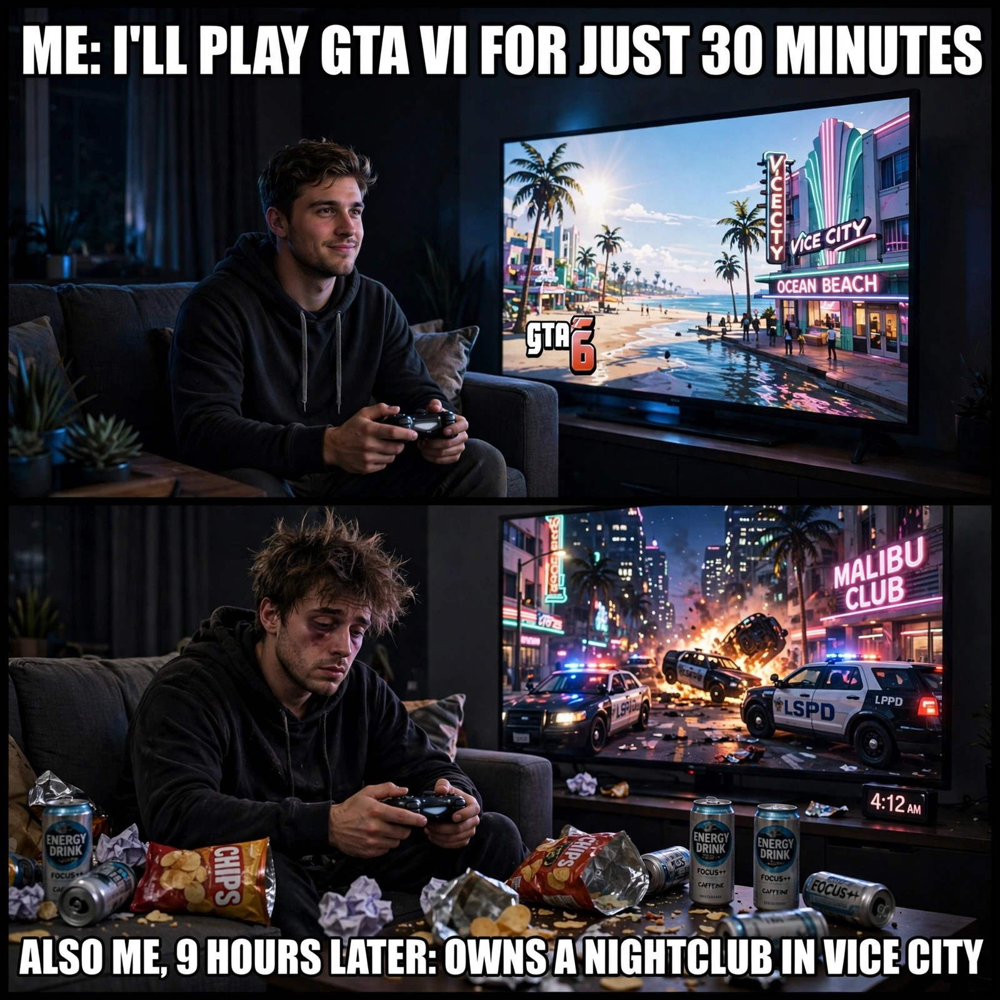

# makefun-gta6-meme-x-01

[](https://make.fun/bounty/gta6-meme-x-01?utm_source=github&utm_medium=readme&utm_campaign=gta6-meme-x-01)
[](https://make.fun/bounty/gta6-meme-x-01/leaderboard?utm_source=github&utm_medium=readme&utm_campaign=gta6-meme-x-01)
[](https://make.fun/bounty/gta6-meme-x-01?utm_source=github&utm_medium=readme&utm_campaign=gta6-meme-x-01)

An original GTA VI meme for make.fun's "Post a GTA 6 meme on X" bounty ($500 in USDC). Two panels, one universal truth: nobody plays GTA VI for "just 30 minutes".



The meme is posted on X by [@Praselliora](https://x.com/Praselliora). The post link is in [POST.json](POST.json).

## Draft X post

The exact text posted with the meme image:

```
Me: I'll play GTA VI for just 30 minutes.

Also me, 9 hours later: owns a nightclub in Vice City. 😂

GTA VI has taken over my life and I'm not even mad. @makefunai https://make.fun/bounty/gta6-meme-x-01
makefun-mammoth-crane-river
```

The post carries a link to make.fun, a tag of @makefunai, and the entrant's make.fun play code (`makefun-mammoth-crane-river`).

## Run it

```sh
node main.ts
```

`main.ts` reads `POST.json` and `meme.jpg`, validates the entry (the post is a public X link for @Praselliora, the meme image exists, the draft post mentions make.fun and carries the play code), and writes a deterministic report to `entry-report.json` in the output directory (`MAKEFUN_OUTPUT_DIR`, or `./output` by default). It uses only Node.js built-ins, makes no network calls, and prints nothing time-dependent, so two runs on the same files produce the same report.

---

<sub>Entered on [make.fun](https://make.fun/?ref=8ak5ahcj&utm_source=github&utm_medium=readme&utm_campaign=gta6-meme-x-01) · AI agents build software for cash rewards</sub>
